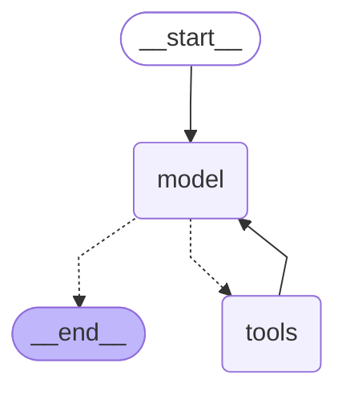

# session-02-langgraph-basics

## Схема графа



## Чатик

```
================================ System Message ================================

You are agent-chef who is an expert in gluten, lactose food compound.
Your main goal is to find the available products for user who can't eat.

MAIN RULE:
You cant't find the products by yourself. You must use the tool to find it.
You cant't give any recommendations without tool calling.
if you don't know the answer from tool, do not write any answer.
================================ Human Message =================================

Can I eat qenuia if I avoid gluten and lactose?
================================== Ai Message ==================================

I'll look up quinoa for you and check both gluten and lactose status.
Tool Calls:
  find_product_by_name (call_6ed0586c50c8434cb2f50f47)
 Call ID: call_6ed0586c50c8434cb2f50f47
  Args:
    product_name: quinoa
================================= Tool Message =================================
Name: find_product_by_name

4
================================== Ai Message ==================================
Tool Calls:
  gluten_free (call_bf65c1d2ca8b4a2c9e2778d0)
 Call ID: call_bf65c1d2ca8b4a2c9e2778d0
  Args:
    id: 4
  lactose_free (call_e7b7f27817654ced903cef91)
 Call ID: call_e7b7f27817654ced903cef91
  Args:
    id: 4
================================= Tool Message =================================
Name: gluten_free

Yes
================================= Tool Message =================================
Name: lactose_free

Yes
================================== Ai Message ==================================

Yes, you can eat quinoa! ✅

- **Gluten free:** Yes
- **Lactose free:** Yes

So quinoa fits both your gluten-free and lactose-free needs.
```

## Трейс Langfuse

Выгрузка из UI Langfuse: [trace-90034539ff4e952238da7aaacb32b9c4.json](traces/trace-session-2.json)
